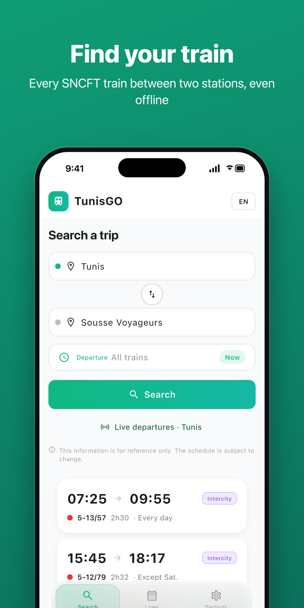
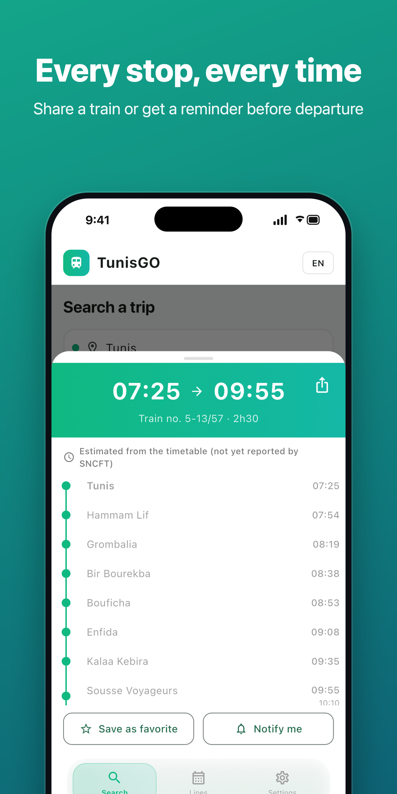
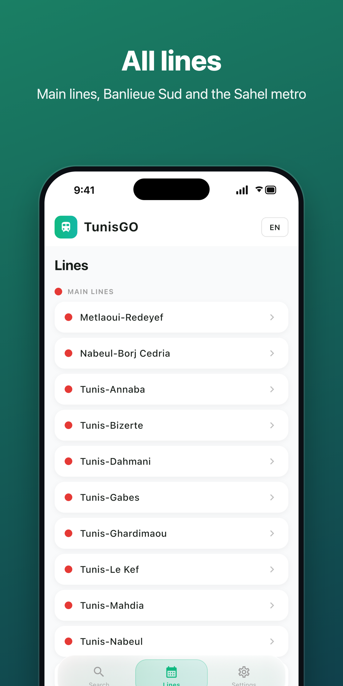
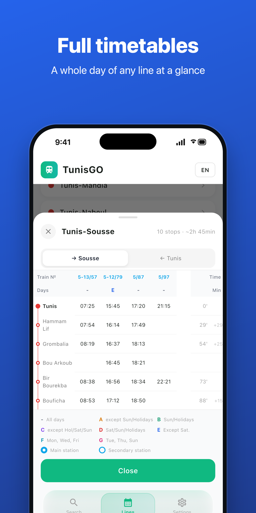
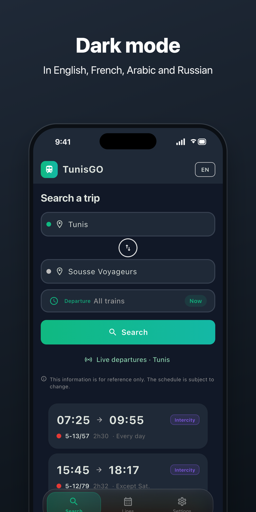

<p align="center">
  <b>بِسْمِ ٱللَّٰهِ ٱلرَّحْمَٰنِ ٱلرَّحِيمِ</b>
</p>

<p align="center">
  
</p>

<h1 align="center">TunisGO</h1>

<p align="center">
  Train, metro and TGM timetables for Tunisia — offline, with live train delays.<br>
  <a href="https://play.google.com/store/apps/details?id=com.tunisgo">Google Play</a> ·
  <a href="https://tunisgo.pages.dev">Website</a> ·
  <a href="CHANGELOG.md">Changelog</a>
</p>

TunisGO is an independent Flutter app for public transport in Tunisia. It covers SNCFT
trains (main lines and suburban) and the TRANSTU light metro and TGM. The whole timetable
is stored on the phone, so search works without internet.

## Features

- **Trip search** between any two stations: departure and arrival, duration, train
  number, every stop and the fare where it is known.
- **SNCFT trains** — main lines and the Tunis and Sahel suburban lines, 150 stations.
- **TRANSTU light metro (M1–M6) and TGM** — 81 stops. TRANSTU publishes only the first
  and last departures and the headway, so times at each stop are estimated and marked
  "estimated" in the app.
- **Live delays** — departure board and trip details show late and cancelled SNCFT trains.
- **Lines** — every line with its full timetable, both directions.
- **Reminders and favorites** — save daily trains and get a notification before departure.
- **Home-screen widget** (Android) with your next favorite trains.
- **Timetable updates over the air** — new timetables arrive without an app update.
- **Four languages** — French, Arabic, English and Russian; station names can be searched
  in each of them. Light and dark theme.

## Screenshots

<p align="center">
  
  
  
  
  
</p>

## Download

<p align="center">
  <a href="https://play.google.com/store/apps/details?id=com.tunisgo">
    
  </a>
  <br>
  
</p>

| Platform | Status |
|----------|--------|
| Android  | Available on Google Play |
| iOS      | Planned |

## How it works

```
assets/db/sncft.db  ─┐                         ┌─ Trip search, Lines, station timetables
                     ├─ SQLite (ATTACH + views) ┤
assets/db/transtu.db ┘                         └─ Reminders, widget

Cloudflare Worker (cloudflare/live-worker)
  ├─ /db/manifest.json + versioned .db files  → over-the-air timetable updates
  └─ live.json (SNCFT live departures, cron)  → delays and cancellations
```

- **Two databases.** `sncft.db` and `transtu.db` are separate files with disjoint id
  ranges. At start the app attaches `transtu.db` and reads both through TEMP views, so the
  queries don't know about the split. If the attach fails, the app runs with SNCFT only.
- **Updates.** Each database has its own version in the Worker manifest; the app downloads
  a newer file, checks its SHA-256 and swaps it in.
- **Live data** comes from the Worker; without a connection the app simply shows the
  timetable.

## Getting started

Requirements: Flutter (stable, Dart `^3.11.1`), Android Studio or Xcode.

```bash
flutter pub get
flutter gen-l10n
flutter run --dart-define=WORKER_URL=https://<your-worker>.workers.dev
```

Without `WORKER_URL` the app works offline only (no live delays, no timetable updates).
`--dart-define=NO_ADS=true` builds without ads.

Tests:

```bash
flutter test
```

### Release builds

Signing uses `android/key.properties` and a keystore that are not in the repository.
Google Play uploads go through fastlane (`android/fastlane`); setup is described in
[docs/PLAY_PUBLISHING.md](docs/PLAY_PUBLISHING.md). The service-account key is read from
outside the repository.

## Project structure

```
lib/
  core/          database (attach, views), models, repositories, theme, shared widgets
  features/      search, results, trip_detail, lines, station_schedule, live,
                 favorites, notifications, widget, settings, limits
  services/      database updater, ads, sharing, reviews
  l10n/          ARB files (template: app_fr.arb)
assets/db/       bundled sncft.db and transtu.db
tools/           timetable database builders (Python, stdlib only)
data/            source data for the builders (TRANSTU lines, stops, notes)
cloudflare/
  live-worker/   Worker: live delays and timetable updates
  site/          generator of the website tunisgo.pages.dev
android/fastlane Play listing texts, screenshots and release notes
```

## Data

- **SNCFT** timetables are compiled from public SNCFT timetables (winter 2026-2027).
- **TRANSTU** times are generated from the official TRANSTU poster "Marche horaire hiver
  2026-2027" (first and last departures, headway); see
  [data/transtu/hiver-2026-2027/NOTES.md](data/transtu/hiver-2026-2027/NOTES.md) for
  sources and assumptions. Build with `python3 tools/build_transtu_db.py --version <x.y.z>`.

TunisGO is not affiliated with, endorsed by or connected to SNCFT (Société Nationale des
Chemins de Fer Tunisiens) or TRANSTU (Société des Transports de Tunis). Timetables can
change; for an important trip, check with the operator.

## Privacy

- No account, no sign-in. Favorites, reminders and settings stay on the device.
- The app downloads timetables and live delays from its own Cloudflare Worker; no personal
  data is sent.
- Ads are served by **Google AdMob**, which may use the advertising ID. In the EEA, UK and
  Switzerland the app asks for consent first, and the choice can be changed in Settings.

Full text: [Privacy Policy](https://tunisgo.pages.dev/privacy/) ·
[Terms of Service](https://tunisgo.pages.dev/terms/).

## Contributing

Issues and pull requests are welcome — especially timetable corrections. Contact:
mnik.dev@proton.me.

## License

[MIT](LICENSE) © 2025 mnik-creator
